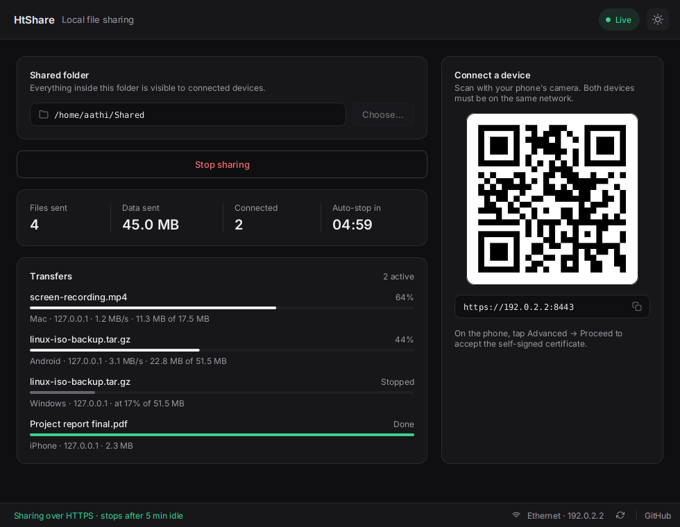
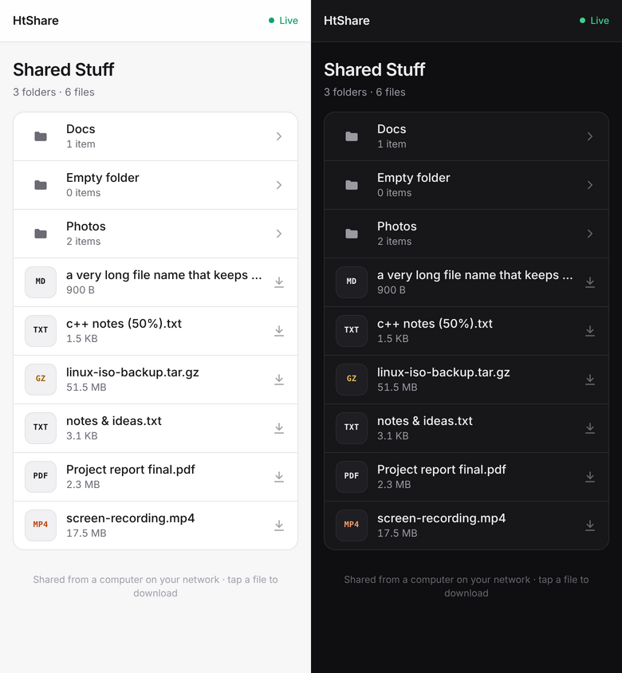

# HtShare

Share a folder from your computer to any phone or laptop on the same network. Pick a folder, press **Start sharing**, scan the QR code. No app is needed on the other device, only its browser.



## Features

- **QR code connect**: scan with the phone camera, or copy the link
- **Asynchronous transfers**: many devices can download at once, and slow ones never hold up the rest (see [How transfers work](#how-transfers-work))
- **Resumable downloads**: byte-range support, so interrupted downloads continue where they stopped and videos can seek
- **Live transfers panel**: every download with its device, speed and progress; finished and stopped ones stay listed
- **HTTPS by default**: TLS 1.3 / 1.2 with a self-signed certificate made at start-up, with HTTP available as a switch
- **Auto-stop**: sharing stops after 5 idle minutes, but never in the middle of a download
- **Drag and drop**: drop a folder onto the window to share it
- **Remembers** your last folder, options and theme
- **Dark and light themes** in the desktop app; the phone page follows the phone's own setting

## The phone side

Folders first, file sizes, and a filter box for big folders. Tap a photo, video, song, PDF or text file to open it in the browser; tap the arrow to download it. The header switches to **Offline** if you stop sharing.



## Install

Download from the [Releases page](https://github.com/TNlucfer01/htshare/releases). Every installer bundles its own Java, so nothing else is needed.

| System | File | How |
| --- | --- | --- |
| **Windows 10/11** | `HtShare-<ver>.msi` | Double-click. Installs for your user only (no admin), adds Start menu + desktop shortcuts. |
| Windows, no install | `HtShare-<ver>-windows-x64.zip` | Unzip anywhere, run `HtShare.exe`. |
| **Ubuntu, Debian, Mint, Pop!_OS** | `htshare_<ver>_amd64.deb` | `sudo apt install ./htshare_<ver>_amd64.deb` |
| **Fedora, openSUSE** | `htshare-<ver>-1.x86_64.rpm` | `sudo dnf install ./htshare-<ver>-1.x86_64.rpm` |
| **Any Linux** (Arch, etc.) | `HtShare-<ver>-x86_64.AppImage` | `chmod +x HtShare-*.AppImage && ./HtShare-*.AppImage` |

The `.deb` and `.rpm` put HtShare in your app menu and add an `htshare` command for the terminal.

**First run on Windows:**
- **SmartScreen:** the installer isn't code-signed, so SmartScreen may warn. Click **More info → Run anyway**.
- **Firewall:** when you first start sharing, Windows Firewall asks whether HtShare may use the network. Allow it on **Private networks**, or phones can't connect.

### From source

Requires JDK 17+ and Maven 3.6+.

```bash
git clone https://github.com/TNlucfer01/htshare.git
cd htshare
mvn javafx:run          # run
mvn test                # tests (includes real HTTP/HTTPS downloads)
mvn clean package       # fat jar at target/htshare-<ver>.jar
```

### Building the installers

GitHub Actions builds them on real Windows and Linux machines (`.github/workflows/installers.yml`):

- every pull request gets the installers as downloadable artifacts
- pushing a tag such as `v1.1.0` (it must match `<version>` in `pom.xml`) attaches them to that release

To build locally, run the same script on the platform you want installers for (Git Bash on Windows):

```bash
JAVAFX_JMODS=~/javafx-jmods-21.0.1 packaging/package.sh
```

It needs:
- JDK 21 with jmods (Temurin has them)
- the [JavaFX 21 jmods](https://gluonhq.com/products/javafx/) for your OS
- on Windows, [WiX Toolset 3](https://wixtoolset.org/docs/wix3/) for the `.msi`
- on Linux, `rpmbuild` for the `.rpm` and `appimagetool` for the AppImage (each is skipped if missing)

Output goes to `build/dist/`.

The bundled Java runtime **must include `jdk.crypto.ec`**: phone browsers only accept ECDHE key exchange, so HTTPS fails without it. The script includes it and checks for it. Don't add a `logback.xml`: reading one pulls in `java.naming`, which the trimmed runtime leaves out. The log level is set in `MainApp` instead (`-Dhtshare.debug=true` for request-level logs).

## How transfers work

The file server is written on Java's NIO.2 asynchronous channels. It uses no web framework, so it adds no dependencies and runs in the small bundled runtime.

```
phone ──TCP──▶ AsynchronousServerSocketChannel ── accept ──▶ HttpConnection (one per client)
                        │                                       │  read head → route → respond → next request
                  2 I/O threads                                 ▼
                  (epoll; a thread only runs                FileResponder
                   when a socket is ready)                   loop: read 256 KB from disk (async)
                                                                   → write it to the client (async)
                                                                   → only then read the next chunk
```

- **No thread per client.** Two I/O threads serve every connection. A thread only does work when the OS reports that a socket is ready, so 40 parallel downloads and a few stalled phones use the same 2 threads.
- **Backpressure.** The next chunk is read from disk only after the client has accepted the previous one, so memory stays at one chunk per transfer however slow the phone is.
- **HTTPS stays async too.** `TlsTransport` runs Java's `SSLEngine` over the same async socket, and the CPU-heavy part of the handshake runs on a worker pool.
- **Disk reads** run on a small worker pool. Java has no true async file I/O on Linux, so this keeps them off the network threads.
- **Timeouts** cut off clients that go silent: 30 s idle, 60 s for a client that stops reading.

Measured on loopback: 40 parallel 50 MB HTTP downloads at about 530 MB/s combined, and 20 parallel HTTPS downloads at about 580 MB/s. The thread count stayed constant throughout, and every file arrived bit-for-bit intact.

## Security

The share is read-only (GET/HEAD only). Requests can't leave the shared folder: `..`, hidden dot-files and dot-folders, and symlinks pointing outside the folder all return 404. Shared `.html` and `.svg` files are served sandboxed, so they can't run scripts. Anyone on the same network with the link can browse the folder. There is no password yet, so share only what you mean to, and don't expose HtShare to the internet.

With HTTPS the phone shows a certificate warning the first time; tap **Advanced → Proceed**. The connection is still encrypted. The warning only means the certificate isn't from a public authority.

## Project structure

```
src/main/java/com/htshare/
├── MainApp.java                    entry point, window, fonts, logging
├── ui/MainController.java          desktop UI logic, transfers panel
├── server/
│   ├── AsyncFileServer.java        accepts connections, routing, path safety, lifecycle
│   ├── FileResponder.java          async file streaming, ranges, caching headers
│   ├── TransferTracker.java        per-device progress and speed for the UI
│   ├── ConnectionMonitor.java      stats and idle auto-stop
│   ├── DeviceNames.java            "Android · 192.168.1.23" labels
│   ├── Helper.java                 phone page rendering, MIME types
│   └── net/
│       ├── Transport.java          async byte pipe interface
│       ├── PlainTransport.java     HTTP over AsynchronousSocketChannel
│       ├── TlsTransport.java       HTTPS: SSLEngine over the same socket
│       ├── HttpConnection.java     keep-alive request loop
│       ├── HttpRequest.java        request parsing
│       └── HttpExchange.java       response writing
└── util/                           network detection, QR codes, certificate generation

src/main/resources/
├── fxml/main.fxml                  desktop layout
├── css/base.css                    desktop components and layout
├── css/{dark,light}-theme.css      palettes (-hs-* colors only)
├── template/home.html              phone page
└── fonts/                          Inter (SIL OFL 1.1)

packaging/package.sh                jar → jlink runtime → .msi/.zip (Windows), .deb/.rpm/AppImage (Linux)
packaging/linux/                    menu entry, AppStream metadata, install scripts
packaging/icons/                    app icon (.svg, .png, .ico)
.github/workflows/installers.yml    builds all installers on Windows + Linux
```

## Troubleshooting

**Phone can't connect**: both devices must be on the same Wi-Fi, and the computer's firewall must allow the port shown in the link (8443 or 8080 by default).
- Windows: allow HtShare when the firewall asks, or in *Windows Security → Firewall → Allow an app*.
- Linux:

  ```bash
  sudo ufw allow 8443/tcp   # or 8080 for HTTP
  ```

**Phone shows the wrong address / can't connect on Windows**: HtShare skips VM, WSL, Docker and VPN adapters when choosing the address for the QR code. If it still picks the wrong one, disconnect the VPN and press the refresh icon in the status bar.

**HTTPS switch is greyed out**: this build's Java runtime lacks `jdk.crypto.ec`. Use a release installer or rebuild with `packaging/package.sh`, or share over HTTP on a trusted network.

**Port already in use**: HtShare picks the next free port automatically and tells you which one it used.

## Roadmap

- [ ] Upload from phone to computer
- [ ] Password / PIN protection
- [ ] Share multiple folders
- [ ] Download a whole folder as a zip
- [ ] System tray

## Built with

Java NIO.2 · [JavaFX](https://openjfx.io/) · [ZXing](https://github.com/zxing/zxing) · [Ikonli](https://kordamp.org/ikonli/) (Feather icons) · [Inter](https://rsms.me/inter/)

## License

MIT. The Inter font is under the SIL Open Font License, see `src/main/resources/fonts/OFL.txt`.
